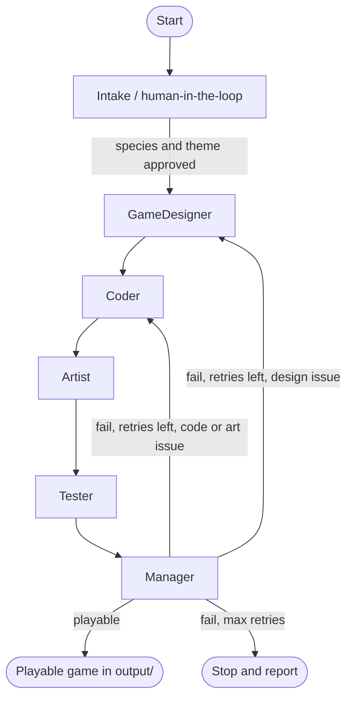

# pet-game-agents

A sample multi-agent framework that collaboratively builds a **pet-raising game** (*game nuôi thú*).

*Tóm tắt: nhiều tác nhân AI cùng nhau thiết kế, lập trình, vẽ và kiểm thử một game nuôi thú, do một Manager điều phối cho đến khi game chơi được.*

Five agents share one LangGraph workflow. They invent the gameplay themselves and only pause for a human on **major decisions** (pet species and theme, or a later scope change). Everything else — hunger, happiness, energy, feeding, playing, sleeping, leveling, art, and tests — is decided and implemented by the crew.

The pipeline runs in two modes:

- **Mock** (default when no API key is set): fully offline and deterministic. This is the mode used in CI. It really writes a playable terminal game and the Tester really runs pytest plus a scripted playthrough.
- **LLM**: optional OpenAI-compatible chat API (`OPENAI_API_KEY`). No real keys are stored in this repository.

## Architecture

Nodes are agents. The happy path is a straight line; a failed test sends work back to the Coder, or to the GameDesigner when the Tester flags a balance/design issue. The Manager stops when the game is playable or when the retry budget is gone.



| Agent | Role |
| --- | --- |
| **Intake** | Asks the user for pet species and theme, unless `--auto-approve` is set. Implemented as a LangGraph `interrupt`, so you can also resume from a callback. |
| **GameDesigner** | Writes a mechanics design: stats, decay, feed/play/sleep effects, and leveling. |
| **Coder** | Writes `output/pet_game.py` and `output/tests/test_pet_game.py`. |
| **Artist** | Writes ASCII mood art and SVG portraits under `output/sprites/`. |
| **Tester** | Runs pytest on the generated tests and a scripted playthrough of the real game. |
| **Manager** | Reads the test report, loops the crew, and stops on success or after `--max-retries`. |

Shared state travels through a LangGraph `StateGraph`. Conditional edges from the Manager close the retry loop.

## Repository layout

```
src/pet_game_agents/     Framework (graph, agents, LLM client, templates)
tests/                   Pytest suite for the workflow itself
output/                  Generated game (created when you run the pipeline)
.env.example             Environment variable template — no secrets
```

## Setup

Python 3.10+ is required.

```bash
python -m venv .venv
source .venv/bin/activate   # Windows: .venv\Scripts\activate
pip install -e ".[dev]"
```

## How to run the agents

### Mock mode (offline, no API key)

```bash
pet-game-agents --mock --auto-approve
# or
python -m pet_game_agents --mock --auto-approve --species cat --theme "cozy backyard companion"
```

This writes a playable game into `output/`. Add `--output path/to/dir` to choose another folder.

### LLM mode

Copy `.env.example` to `.env` and set a key. The client speaks the OpenAI Chat Completions API, so a compatible proxy works too.

```bash
cp .env.example .env
# edit .env: OPENAI_API_KEY, optional OPENAI_BASE_URL and OPENAI_MODEL
pet-game-agents --llm --auto-approve
```

`LLM_MODE=auto` (the default) uses the LLM when `OPENAI_API_KEY` is set, and mock mode otherwise.

### Human-in-the-loop

Omit `--auto-approve` and the graph pauses once, asking for a species and theme. Press Enter to accept the defaults, or type:

```
dragon | tiny volcano hatchling
```

From Python you can pass a callback instead of a prompt:

```python
from pet_game_agents import run_pipeline

def on_major_decision(payload):
    print(payload["question"])
    return {"species": "bunny", "theme": "garden tea party"}

result = run_pipeline(mode="mock", auto_approve=False, human_handler=on_major_decision)
```

## How to play the generated game

```bash
python output/pet_game.py
```

Commands: **[F]eed**, **[P]lay**, **[S]leep**, **[W]ait**, **[H]elp**, **[Q]uit**.

Hunger is a fullness meter (100 is well fed, 0 is starving). Happiness and energy work the same way: higher is better. Every action advances a turn and applies a little idle decay, so you have to keep caring for your pet. Actions earn XP; reach level 5 without letting a stat hit zero.

A non-interactive run, useful for checks:

```bash
python output/pet_game.py --script feed,play,sleep,feed,play,sleep
```

## How to extend

- **Add an agent** — write a node function that takes `BuildState` and returns a partial update, then register it in `src/pet_game_agents/graph.py` with a new edge.
- **Change the retry policy** — edit `route_after_manager` in `agents/manager.py`. Today, design-flagged failures go back to GameDesigner; everything else goes back to Coder (who then re-runs Artist and Tester).
- **Support another model provider** — `src/pet_game_agents/llm.py` already takes `OPENAI_BASE_URL`. Point it at any OpenAI-compatible endpoint.
- **Change default species or art** — extend `default_design()` and the ASCII/SVG maps in `agents/artist.py`. Mock mode will pick them up immediately.
- **Tighten playability rules** — edit `agents/tester.py` and the generated test template `templates/test_pet_game.py.tmpl`.

## Tests

```bash
pytest
```

The suite runs the mock pipeline end to end, checks the human interrupt/resume path, verifies that a first-pass coding failure is retried until the game is playable, and confirms that auto mode without an API key stays offline.

## License

MIT. See [LICENSE](LICENSE).
